<p align="center">
  
</p>

# alltradingapi

Python client for the [All Trading API](https://alltradingapi.com) — candles,
assets, saved candles, candle history, chart images and trade result checks
for Quotex.

- Zero dependencies, standard library only
- Sync and async clients
- Typed, ships `py.typed`
- Automatic retries on rate limits and server errors
- Python 3.10+

| | |
|---|---|
| [](https://pypi.org/project/alltradingapi/) | [](https://pypi.org/project/alltradingapi/) |
| [](LICENSE) | [](https://github.com/alltradingapi/alltradingapi-python/actions) |

## Install

```
pip install alltradingapi
```

Get an API key from [alltradingapi.com](https://alltradingapi.com). Each
endpoint type has its own key. The simplest setup is one default key:

```
export ATA_API_KEY=ap_yourkey
```

You can also pass keys per product, or per call — see
[authentication](#authentication).

## Quickstart

```python
from alltradingapi import Client

with Client() as ata:  # uses ATA_API_KEY
    assets = ata.assets(only_open=True)
    print("open assets:", len(assets))

    candles = ata.candles("EURUSD_otc", hours=2, timeframe="1m")
    print("last close:", candles[-1].close)
```

## Endpoints

| method | endpoint | returns |
|---|---|---|
| `ata.assets()` | `/qx_assets` | list of assets with open state and payouts |
| `ata.candles(asset)` | `/qx_candles` | current candles (OHLC) |
| `ata.history(asset)` | `/qx_history` | candle history |
| `ata.saved(asset)` | `/qx_saved` | saved candles from the archive |
| `ata.screenshot(asset)` | `/qx_ss_pro_v2` | chart image as PNG bytes |
| `ata.result(asset, time, direction)` | `/qx_result` | trade result check |

Common options: `timeframe` (`5s`…`4h`), `timezone` (`"-3"`, `"UTC"`,
`"Asia/Dhaka"`, …), `hours` (1–24), `count` (1–1000 for saved candles).
Invalid values raise `ValidationError` before any request is sent.

## Saving a chart image

```python
png = ata.screenshot("EURUSD_otc", timeframe="1m")
with open("chart.png", "wb") as f:
    f.write(png)   # real PNG, 1200x680, returned by the API
```

## Result check

```python
outcome = ata.result("EURUSD_otc", time="20:00", direction="call", mtg=1)
print(outcome.result)        # TradeOutcome.WIN / LOSE / REFUND / PENDING / ...
```

## Async

```python
import asyncio
from alltradingapi import AsyncClient

async def main():
    async with AsyncClient() as ata:
        assets = await ata.assets(only_open=True)
        symbols = [a.symbol for a in assets if a.is_otc][:10]

        # candles for many assets at once; failures stay per-asset
        results = await ata.scan(symbols, hours=1)
        for symbol, candles in results.items():
            if not isinstance(candles, Exception):
                print(symbol, len(candles), "candles")

asyncio.run(main())
```

## Authentication

Keys are sent as a bearer header by default. Resolution order:

1. per-call `api_key=...`
2. `Client(keys={"quotex-candles": "ap_..."})`
3. `Client(keys={"default": "ap_..."})`
4. `Client(api_key="ap_...")`
5. `ATA_API_KEY` environment variable
6. per-product `ATA_KEY_QUOTEX_CANDLES`, `ATA_KEY_QUOTEX_ASSETS`, etc.

Use `auth_mode="query"` if you prefer `?key=` in the URL instead.

## Errors and retries

429 and 5xx responses are retried automatically with backoff, honouring
`Retry-After`. After the retries are exhausted you get a specific exception:

```python
from alltradingapi.errors import (
    ALLError, AuthenticationError, PermissionDeniedError,
    RateLimitError, ValidationError, UpstreamError,
)

try:
    candles = ata.candles("EURUSD_otc")
except RateLimitError as e:
    print("slow down, retry after", e.retry_after, "s")
except ValidationError as e:
    print("bad parameter:", e.message)
except UpstreamError:
    print("feed is down, try again later")
```

Every error carries `.status`, `.message`, `.payload` and a redacted `.url`.

## Staying up to date

The client checks PyPI once per process and refuses to run if a newer
version exists, unless you opt out:

```python
ata = Client(update_policy="warn")     # strict (default) | ask | warn | off
```

Escape hatches: `ATA_UPDATE_POLICY=off`, `ATA_SKIP_UPDATE=1`,
`Client(allow_outdated=True)`. Check without gating:
`ata.check_updates(force=True)`.

## More examples

See the [examples/](examples/) folder: quickstart, candle history with a
sparkline, and chart images with async scanning.

## License & disclaimer

MIT — see [LICENSE](LICENSE). © 2026 All Trading API.

Independent, unofficial API. Not affiliated with, endorsed by, or connected
to Quotex. Trading involves substantial risk. This SDK provides market data
only — it cannot place trades and is not financial advice.
